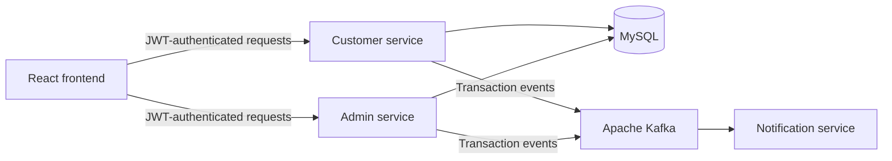

# BankSphere

A personal banking application project built around **Java, Spring Boot, MySQL, and Apache Kafka**, with a React interface and JWT authentication.

This repository is the **project overview and architecture guide**. The backend implementation lives in the three service repositories linked below.

## Explore the source

| Service | Responsibility | Repository |
| --- | --- | --- |
| Customer | Customer onboarding, deposits, withdrawals, transfers, and PDF transaction statements | [customer_service](https://github.com/Narasimha9271/customer_service) |
| Admin | Customer management and transaction administration | [admin_service](https://github.com/Narasimha9271/admin_service) |
| Notification | Consume transaction events from Kafka and handle notifications | [notification_service](https://github.com/Narasimha9271/notification_service) |

For a backend review, start with the customer service, then follow the event flow into the notification service.

## Features

- Customer and admin login with JWT authentication and role-based dashboards.
- Deposits, withdrawals, fund transfers, and transaction history.
- Downloadable PDF transaction statements using iTextPDF.
- Kafka-based event communication between banking operations and notifications.
- React and Tailwind CSS interface for customer and administrative workflows.

## Architecture overview

The diagram shows the project's logical components. Consult each service's source and configuration for its endpoints, database connections, and Kafka settings.

## Technology

**Backend:** Java, Spring Boot · **Persistence:** MySQL · **Messaging:** Apache Kafka · **Authentication:** JWT · **Frontend:** React, Tailwind CSS · **Statements:** iTextPDF

## Working with the project

Cloning this overview repository provides documentation only. Open the service repositories above to inspect or run the backend components; each service needs its own application configuration and access to its required infrastructure. This repository does not currently provide a combined startup script or a hosted demo.
